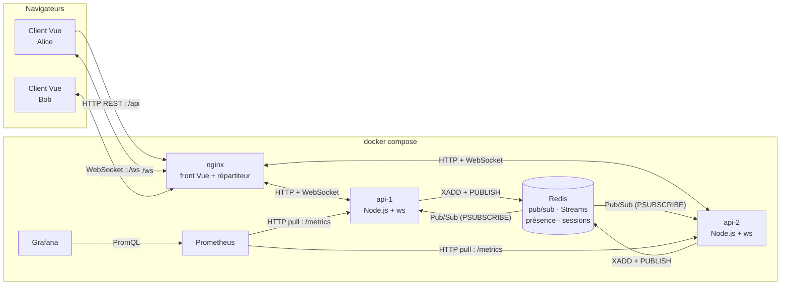

# TubbyChat — Phase 1 : sujet et conception

> Projet fil rouge · Web temps réel · Filière IW · Livrables de la phase 1 (J1)

| Livrable demandé | Section |
|------------------|---------|
| Sujet, utilisateurs, scénario principal en 5 étapes | [1](#1-sujet-utilisateurs-scénario) |
| Schéma d'architecture (composants, flux, technique temps réel par flux) | [2](#2-schéma-darchitecture) |
| Tableau de décision (au moins deux alternatives par choix majeur) | [3](#3-tableau-de-décision) |
| Contrat de messages (types, champs, sens, exemple JSON) | [4](#4-contrat-de-messages) |
| Dépôt Git initialisé, accessible au formateur | [5](#5-dépôt-git) |

---

## 1. Sujet, utilisateurs, scénario

### Sujet
**TubbyChat** est une **messagerie temps réel** avec **salons**, **présence** (qui est en ligne) et **accusés de lecture**, sur le thème des Télétubbies. Chaque utilisateur choisit son Tubby (violet, vert, jaune ou rouge) et discute dans des salons : La Colline, La Maison Tubby, Le Jardin, Le Soleil, et Le placard de Noo-Noo, réservé aux administrateurs.

Cadre IW : *application collaborative ou messagerie* (exemple de la fiche : « messagerie avec salons, présence et accusés de lecture »).

### Utilisateurs
| Profil | Besoin |
|--------|--------|
| **Membre** (étudiant d'une promo) | Discuter par thème, voir qui est là, savoir si son message a été lu, ne rien perdre en cas de coupure réseau |
| **Administrateur** | Accéder en plus à un salon réservé (démonstration des contrôles d'autorisation) |

### Scénario principal (5 étapes)
1. **Alice crée son Tubby** (pseudo, mot de passe, couleur) ou se connecte.
2. **Elle rejoint « La Colline »** : elle voit les derniers messages et la liste des Tubbies en ligne.
3. **Elle écrit un message** : Bob, connecté depuis un autre navigateur (et une autre instance du serveur), le reçoit en moins d'une seconde.
4. **Bob lit le message** : Alice voit apparaître « Lu par bob ».
5. **Alice perd le réseau 10 secondes** : son client se reconnecte seul et récupère les messages manqués.

---

## 2. Schéma d'architecture



### Composants
| Composant | Rôle |
|-----------|------|
| **Client Vue 3** (navigateur) | Interface ; ouvre le WebSocket avec un ticket ; se reconnecte seul et rattrape les messages manqués |
| **nginx** | Sert le front ; répartit `/api` et `/ws` entre les deux instances ; bloque `/metrics` depuis l'extérieur |
| **api-1, api-2** (Node.js + `ws`) | Le même code lancé deux fois : authentification, validation, autorisation, diffusion |
| **Redis** | Broker entre instances (pub/sub) + stockage partagé : historique (Streams), présence, sessions, tickets |
| **Prometheus + Grafana** | Mesures : connexions, messages par seconde, latence, erreurs (phase 5) |

### Technique temps réel par flux
| Flux | Sens | Technique | Pourquoi |
|------|------|-----------|----------|
| Messages, « en train d'écrire », accusés de lecture, présence | navigateur ⇄ serveur | **WebSocket** | Échanges fréquents dans les deux sens |
| Inscription, connexion, ticket WebSocket, liste des salons | navigateur → serveur | **HTTP REST** | Actions ponctuelles, protégées par cookie et politique de même origine |
| Diffusion d'un message entre instances | serveur → serveurs | **Redis Pub/Sub** | Alice sur api-1 doit atteindre Bob sur api-2 |
| Historique et reprise après coupure | serveur ⇄ Redis | **Redis Streams** | Identifiants ordonnés : « tout ce qui suit l'id X » |
| Métriques | Prometheus → serveurs | **HTTP pull** | Format standard de Prometheus |

---

## 3. Tableau de décision

| Décision | ✅ Choix retenu | Alternative 1 | Alternative 2 | Justification |
|----------|----------------|---------------|---------------|---------------|
| **Technique temps réel** | WebSocket | SSE + requêtes POST | Long polling | Une messagerie communique dans les deux sens et souvent. SSE ne va que du serveur vers le client (il faudrait un POST par action). Le long polling coûte une requête HTTP par message. |
| **Bibliothèque serveur** | `ws` (Node.js) | Socket.IO | uWebSockets.js | `ws` est proche du protocole : reconnexion, salons et sécurité sont écrits par nous, donc expliqués et démontrés. Socket.IO les cacherait. uWS est plus rapide mais moins documenté. |
| **Broker entre instances** | Redis | NATS | Kafka | Un seul service couvre diffusion, historique, présence, sessions et tickets. NATS ne fait que la diffusion. Kafka est surdimensionné pour un chat et lourd à lancer. |
| **Stockage de l'historique** | Redis Streams | PostgreSQL | MongoDB | Identifiants ordonnés, idéaux pour la reprise. Une base en plus n'apporte rien sur 4 jours. *Limite assumée : 1000 messages par salon.* |
| **Authentification WebSocket** | Ticket à usage unique (30 s) | JWT dans l'URL | Jeton dans le 1er message | Le navigateur ne permet pas d'en-tête `Authorization` sur un WebSocket. Un JWT dans l'URL finit dans les journaux. Avec un jeton au 1er message, on accepte des connexions anonymes. Le ticket permet de refuser dès la poignée de main, et une fuite est sans effet. |
| **Répartiteur** | nginx | HAProxy | Traefik | nginx sert aussi le front Vue : un seul conteneur. Configuration WebSocket bien documentée. |
| **Front** | Vue 3 + Vite | React | HTML/JS sans framework | La réactivité met à jour seule la présence et les messages. Vue échappe le HTML par défaut (protection XSS). |
| **Format des messages** | JSON | MessagePack | Protobuf | Lisible dans l'onglet Réseau du navigateur : on peut vérifier la conformité au contrat (critère de la phase 2). |
| **Outil de charge** | k6 | Artillery | Script Node maison | Script JS versionné, WebSocket intégré, percentiles p50/p95 fournis. |
| **Garantie de livraison** | Au moins une fois + dédoublonnage | Au plus une fois (pub/sub seul) | Exactement une fois | Le pub/sub seul perd les messages pendant une coupure. « Exactement une fois » est coûteux. On combine reprise par Stream et dédoublonnage par identifiant. |

---

## 4. Contrat de messages

### 4.1 Règles générales
- Chaque message est un **objet JSON** avec un champ `type`, de **8 Kio maximum**.
- Le schéma est **strict** : type inconnu, champ inconnu ou mauvais type → message `error`, et **la connexion reste ouverte**.
- Salon : `^[a-z0-9-]{1,32}$` · texte : 1 à 1000 caractères.
- `id` = identifiant Redis Stream (`"1793617914799-0"`, ordonné dans le temps).
- L'auteur (`from`, `color`) est **ajouté par le serveur** depuis la session, jamais lu dans le message du client.
- `clientMsgId` (UUID généré par le client) : si le même message est renvoyé après une reconnexion, le serveur ne l'enregistre pas deux fois.
- Le serveur peut regrouper plusieurs messages dans un **tableau JSON** (optimisation `BATCH_MS`) : le client traite alors chaque élément.

### 4.2 Client → serveur

| `type` | Champs | Rôle | Exemple |
|--------|--------|------|---------|
| `join` | `room`, `since` (facultatif) | Rejoindre un salon ; avec `since`, reprise après l'id donné | `{"type":"join","room":"colline","since":"1793617914799-0"}` |
| `leave` | `room` | Quitter un salon | `{"type":"leave","room":"colline"}` |
| `chat` | `room`, `text`, `clientMsgId` | Envoyer un message | `{"type":"chat","room":"colline","text":"Eh-oh !","clientMsgId":"5f0c2a9e-8d3b-4c41-9a7e-1b2c3d4e5f60"}` |
| `typing` | `room` | « En train d'écrire » (au plus un toutes les 1,5 s) | `{"type":"typing","room":"colline"}` |
| `read` | `room`, `upTo` | J'ai lu jusqu'à ce message | `{"type":"read","room":"colline","upTo":"1793617914799-0"}` |
| `reauth` | `ticket` | Renouveler la session sans couper la connexion | `{"type":"reauth","ticket":"q3Vt0kHq…"}` |

### 4.3 Serveur → client

| `type` | Champs | Quand | Exemple |
|--------|--------|-------|---------|
| `welcome` | `user`, `color`, `role`, `instance`, `sessionSeconds` | Juste après l'ouverture | `{"type":"welcome","user":"alice","color":"violet","role":"membre","instance":"api-2","sessionSeconds":900}` |
| `joined` | `room`, `members[]`, `reads{}` | Réponse à `join` | `{"type":"joined","room":"colline","members":[{"user":"bob","color":"vert"}],"reads":{"bob":"1793617914799-0"}}` |
| `history` | `room`, `messages[]`, `complete`, `resumed` | Après `join` : derniers messages, ou messages manqués si `since` | `{"type":"history","room":"colline","messages":[],"complete":true,"resumed":false}` |
| `chat` | `room`, `id`, `from`, `color`, `text`, `at`, `clientMsgId`, `via` | Message diffusé à tous les membres du salon | `{"type":"chat","room":"colline","id":"1793617914799-0","from":"alice","color":"violet","text":"Eh-oh !","at":1793617914799,"clientMsgId":"5f0c2a9e-…","via":"api-1"}` |
| `ack` | `clientMsgId`, `id`, `duplicate` (facultatif) | À l'expéditeur : message enregistré | `{"type":"ack","clientMsgId":"5f0c2a9e-…","id":"1793617914799-0"}` |
| `presence` | `room`, `user`, `status`, `color` (si en ligne) | Arrivée ou départ | `{"type":"presence","room":"colline","user":"bob","color":"vert","status":"online"}` |
| `typing` | `room`, `user`, `color` | Quelqu'un écrit | `{"type":"typing","room":"colline","user":"bob","color":"vert"}` |
| `read` | `room`, `user`, `upTo` | Quelqu'un a lu | `{"type":"read","room":"colline","user":"bob","upTo":"1793617914799-0"}` |
| `session_expiring` | `inSeconds` | Avant la fin de la session (60 s, ou un tiers de sa durée si elle est courte) | `{"type":"session_expiring","inSeconds":60}` |
| `reauth_ok` | `sessionSeconds` | Renouvellement accepté | `{"type":"reauth_ok","sessionSeconds":900}` |
| `error` | `code`, `message`, `room` ou `strikes` (facultatifs) | Message refusé, connexion conservée | `{"type":"error","code":"invalid_message","message":"champ invalide : text"}` |

**Codes d'erreur** : `invalid_json`, `invalid_message`, `forbidden`, `not_in_room`, `rate_limited`, `internal`.

### 4.4 Codes de fermeture

| Code | Signification | Réaction du client |
|------|---------------|--------------------|
| 1000 | Fermeture normale | Aucune |
| 1001 | Instance arrêtée | Reconnexion rapide (sur l'autre instance) |
| 1008 | Débit abusif | Reconnexion avec délai |
| 1009 | Message trop gros (> 8 Kio) | Reconnexion, message signalé « trop long » |
| 4001 | Session expirée | Nouveau ticket, puis reconnexion |
| 4003 | Accès révoqué (déconnexion) | Pas de reconnexion : retour à l'écran de connexion |

### 4.5 Routes HTTP associées

| Route | Corps → réponse | Rôle |
|-------|-----------------|------|
| `POST /api/register` | `{"username":"alice","password":"…","color":"violet"}` → 201 + cookie de session | Créer un compte |
| `POST /api/login` | `{"username":"alice","password":"…"}` → 200 + cookie `sid` (HttpOnly, SameSite=Strict) | Se connecter |
| `POST /api/logout` | → 204, fermeture des WebSockets de l'utilisateur (4003) | Se déconnecter partout |
| `GET /api/me` | → `{"user":"alice","color":"violet","role":"membre"}` | Qui suis-je ? |
| `POST /api/ws-ticket` | → `{"ticket":"q3Vt0kHq…","expiresIn":30}` | Ticket WebSocket à usage unique |
| `GET /api/rooms` | → `[{"name":"colline","label":"La Colline","color":"rouge",…}]` | Liste des salons |

### 4.6 Poignée de main WebSocket

```
GET /ws?ticket=q3Vt0kHq… HTTP/1.1
Origin: http://localhost:8090
Upgrade: websocket
```
| Réponse | Cas |
|---------|-----|
| `101 Switching Protocols` | Origine autorisée et ticket valide |
| `403 Forbidden` | Origine absente de la liste blanche |
| `401 Unauthorized` | Ticket absent, expiré ou déjà utilisé |
| `429 Too Many Requests` | Trop de connexions (par IP ou par utilisateur) |

---

## 5. Dépôt Git

- Dépôt : `https://github.com/<compte>/tubbychat` *(à compléter)*
- Formateur ajouté comme collaborateur : *(à compléter)*
- Lancement : `docker compose up --build`, puis http://localhost:8090 (voir `README.md`)
