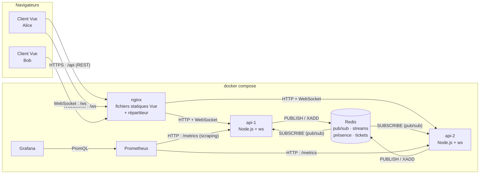
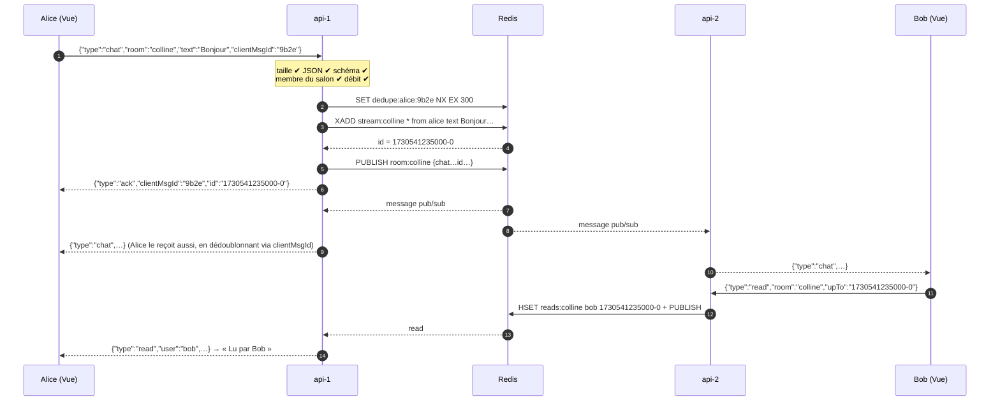
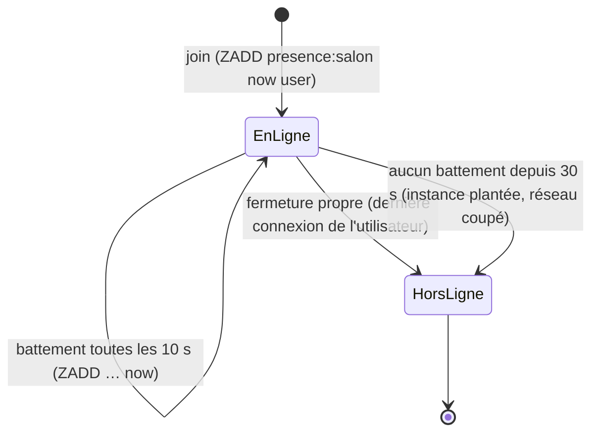

# TubbyChat — Architecture du projet fil rouge

> Messagerie temps réel avec salons, présence et accusés de lecture, aux couleurs des Télétubbies.
> Filière IW · Stack : **Node.js + ws** (serveur), **Vue 3 + Vite** (client), **Redis** (broker), **nginx** (répartiteur), **Prometheus + Grafana** (mesures).
> Tout se lance avec `docker compose up --build` → http://localhost:8090
> **Statut : implémenté et testé** (voir [`README.md`](../README.md) pour le lancement et les démonstrations, [`PHASE5.md`](PHASE5.md) pour les mesures).

Ce document sert de référence au groupe pendant les 4 jours. Il suit les 6 phases de la fiche projet. Chaque section indique **ce qu'on construit**, **pourquoi**, et **comment le prouver** devant le formateur.

---

## Sommaire

1. [Le sujet en 30 secondes](#1-le-sujet-en-30-secondes)
2. [Vue d'ensemble de l'architecture](#2-vue-densemble-de-larchitecture)
3. [Les composants un par un](#3-les-composants-un-par-un)
4. [Tableau de décision](#4-tableau-de-décision)
5. [Contrat de messages](#5-contrat-de-messages)
6. [Parcours d'un message, de bout en bout](#6-parcours-dun-message-de-bout-en-bout)
7. [Sécurité (phase 3)](#7-sécurité-phase-3)
8. [Reconnexion, reprise et présence (phase 3)](#8-reconnexion-reprise-et-présence-phase-3)
9. [Passage à l'échelle (phase 4)](#9-passage-à-léchelle-phase-4)
10. [Charge, observabilité, optimisation (phase 5)](#10-charge-observabilité-optimisation-phase-5)
11. [Thème Télétubbies (interface)](#11-thème-télétubbies-interface)
12. [Arborescence du dépôt](#12-arborescence-du-dépôt)
13. [docker compose](#13-docker-compose)
14. [Planning par phase et répartition](#14-planning-par-phase-et-répartition)
15. [Limites assumées](#15-limites-assumées)

---

## 1. Le sujet en 30 secondes

**TubbyChat** est une messagerie de groupe : on se connecte, on rejoint des salons (« La Colline », « La Maison Tubby », « Le Jardin »…), on discute en temps réel, on voit qui est en ligne et qui a lu les messages.

**Utilisateurs** : des étudiants d'une même promo qui veulent discuter par thème.

**Scénario principal (5 étapes)** — à mettre tel quel dans le README :

1. Alice crée un compte ou se connecte.
2. Elle rejoint le salon « La Colline » et voit l'historique récent ainsi que la liste des personnes en ligne.
3. Elle écrit un message : Bob, connecté depuis un autre navigateur (et une autre instance du serveur), le reçoit en moins d'une seconde.
4. Bob lit le message : Alice voit l'accusé de lecture « Lu par Bob ».
5. Alice perd le réseau 10 secondes : son client se reconnecte seul et récupère les messages manqués.

---

## 2. Vue d'ensemble de l'architecture



**Technique temps réel par flux** (critère de la phase 1 : chaque flux porte le nom de sa technique) :

| Flux | Sens | Technique | Pourquoi |
|------|------|-----------|----------|
| Messages, saisie en cours, accusés de lecture, présence | bidirectionnel | **WebSocket** (`ws`) | Le client envoie souvent (messages, « en train d'écrire », lu) : il faut un canal dans les deux sens. |
| Connexion, inscription, obtention d'un ticket, liste des salons | client → serveur | **HTTP REST** (`fetch`) | Actions ponctuelles, protégées par la politique de même origine et les cookies. |
| Diffusion entre instances | serveur → serveur | **Redis pub/sub** | Un message reçu par api-1 doit atteindre les clients connectés à api-2. |
| Historique et reprise | serveur ↔ Redis | **Redis Streams** | Chaque message reçoit un identifiant ordonné, ce qui permet de rejouer « tout ce qui suit l'id X ». |
| Métriques | Prometheus → serveurs | **HTTP pull** (`/metrics`) | Le format standard de Prometheus. |

---

## 3. Les composants un par un

### nginx — porte d'entrée unique
- Sert le build du client Vue (`/`).
- Fait **répartiteur** entre `api-1` et `api-2` pour `/api` et `/ws`.
- Transmet les en-têtes `Upgrade` et `Connection`, indispensables au WebSocket.
- Garde `/metrics` **inaccessible** depuis l'extérieur.
- Dans le cadre du projet, on reste en HTTP sur `localhost`. En production, nginx ferait la terminaison TLS (`wss://`) : la configuration est fournie, en commentaire.

### api-1 / api-2 — serveur Node.js (`ws` + `node:http`)
Le même code, lancé deux fois avec une variable `INSTANCE_ID` différente. Le serveur a quatre responsabilités :
1. **HTTP** : `/api/register`, `/api/login`, `/api/logout`, `/api/ws-ticket`, `/api/rooms`, `/metrics`.
2. **Poignée de main WebSocket** : vérifie l'origine, consomme le ticket et applique le quota de connexions. Repris de la démo M6.
3. **Messages** : validation, autorisation, limitation de débit, puis traitement (écriture dans Redis et diffusion).
4. **Présence et expiration** : battement de cœur, échéance de session, révocation.

Le serveur est **sans état local important**. Tout ce qui doit survivre ou être partagé (sessions, tickets, historique, présence) vit dans Redis. On peut donc arrêter une instance : les clients se reconnectent sur l'autre sans rien perdre.

### Redis — broker et stockage partagé
Un seul service, utilisé pour cinq choses différentes :

| Usage | Structure Redis | Clé |
|-------|-----------------|-----|
| Diffusion entre instances | Pub/Sub | canal `room:{nom}` et `user:{nom}` (révocation) |
| Historique, reprise | Stream (`XADD` / `XRANGE`), limité à ~1000 messages par salon | `stream:{salon}` |
| Présence | Sorted set (score = dernier battement de cœur) | `presence:{salon}` |
| Accusés de lecture | Hash utilisateur → dernier id lu | `reads:{salon}` |
| Sessions et tickets | String avec expiration (`SET … EX`) | `session:{sid}`, `ticket:{t}`, `dedupe:{user}:{clientMsgId}` |
| Comptes | Hash (mot de passe haché avec `scrypt`) | `user:{nom}` |

Persistance : option `appendonly yes` (AOF), pour que l'historique survive à un redémarrage du conteneur.

### Client Vue 3 (Vite)
- `socket.js` : encapsule le WebSocket (ticket, reconnexion avec délai croissant, reprise, file d'envoi).
- `store.js` : un seul objet `reactive()` de Vue (salons, messages, présence, accusés de lecture). Pas besoin de Pinia pour cette taille d'application.
- L'affichage des messages passe **toujours** par l'interpolation Vue `{{ }}`, qui échappe le HTML. On n'utilise **jamais** `v-html` sur du contenu utilisateur (protection XSS).

### Prometheus + Grafana — mesures
- Prometheus interroge `/metrics` sur chaque instance toutes les 5 s.
- Grafana affiche le tableau de bord de la phase 5, provisionné automatiquement depuis le dépôt.

---

## 4. Tableau de décision

Au moins deux alternatives comparées pour chaque choix majeur (critère de la grille C).

| Décision | Choix retenu | Alternative 1 | Alternative 2 | Pourquoi ce choix |
|----------|--------------|---------------|---------------|-------------------|
| Technique temps réel | **WebSocket** | SSE + POST | Long polling | Les échanges sont bidirectionnels et fréquents (saisie en cours, lu). SSE obligerait à envoyer chaque action par un POST séparé, et le long polling coûte une requête par message. |
| Bibliothèque serveur | **ws** | Socket.IO | uWebSockets.js | `ws` est minimal et proche du protocole : chaque mécanisme (reconnexion, salons, sécurité) est écrit et expliqué par nous. Socket.IO masquerait ce qu'on doit justement démontrer. uWS est plus rapide mais moins documenté. |
| Broker | **Redis** | NATS | Kafka | Un seul service couvre pub/sub, historique (Streams), présence et tickets. NATS ne fait que la diffusion (JetStream ajouterait l'historique, mais c'est un outil de plus). Kafka est surdimensionné pour un chat et lourd à lancer. |
| Stockage de l'historique | **Redis Streams** | PostgreSQL | MongoDB | Les ids des Streams sont ordonnés et parfaits pour la reprise (`XRANGE id+`). Une base relationnelle ajouterait un conteneur et un ORM sans gain pour 4 jours. Limite assumée : historique tronqué à ~1000 messages par salon. |
| Authentification WebSocket | **Ticket à usage unique** (30 s) | JWT dans l'URL | Jeton dans le premier message | Refus dès la poignée de main, et rien d'exploitable dans les journaux (voir le support M6). |
| Répartiteur | **nginx** | HAProxy | Traefik | Il sert aussi le front : un seul conteneur. Configuration WebSocket connue et documentée. |
| Front | **Vue 3 + Vite** | React | HTML/JS vanilla | La réactivité de Vue simplifie la mise à jour de la liste de présence et des messages. L'échappement HTML est automatique. |
| Format des messages | **JSON** | MessagePack | Protobuf | Lisible dans l'onglet Réseau (critère de la phase 2 : messages observables et conformes au contrat). MessagePack pourrait être testé en optimisation (phase 5). |
| Outil de charge | **k6** | Artillery | script Node maison | Script versionné en JS, support WebSocket intégré, export des percentiles p50/p95. |

---

## 5. Contrat de messages

Le contrat complet et à jour (types, champs, sens, exemples JSON, codes de fermeture, routes HTTP) est dans **[`PHASE1.md` §4](PHASE1.md#4-contrat-de-messages)**. Le code qui le fait respecter est `server/src/ws/schema.js`.

---

## 6. Parcours d'un message, de bout en bout

Alice est connectée à **api-1**, Bob à **api-2**.



Points à expliquer à l'oral :
- **L'ordre des opérations** : on écrit d'abord dans le Stream (durable), puis on publie (éphémère). Si la publication est perdue, le message est quand même récupérable à la reprise.
- **Le `SET NX`** (« écrire seulement si la clé n'existe pas ») empêche un message renvoyé après une reconnexion d'être enregistré deux fois.
- **Le client affiche le message tout de suite** en grisé (« envoi… »), puis le confirme à la réception de l'`ack` (affichage optimiste).

---

## 7. Sécurité (phase 3)

Le code de la démo M6 (`M6/demo/server.js`) est la base directe de cette partie.

| Mécanisme | Où | Détail | Test qui le prouve |
|-----------|----|--------|--------------------|
| Origine | poignée de main | Liste blanche exacte (`ALLOWED_ORIGINS`, variable d'environnement). Origine inconnue → **403** | `wscat -o https://evil.example` → 403 |
| Authentification | poignée de main | Ticket aléatoire de 30 s, à usage unique, stocké dans Redis (partagé entre instances) et supprimé à la lecture (`GETDEL`). Absent ou invalide → **401** | Connexion sans `?ticket` → 401 ; rejeu → 401 |
| Quota de connexions | poignée de main | 5 connexions max par utilisateur, 50 par IP → **429** | Script qui ouvre 6 onglets |
| Taille | trame | `maxPayload: 8 * 1024`, et un écouteur `ws.on('error')` **obligatoire** (sinon le processus s'arrête) | Message de 20 Kio → 1009, le serveur reste debout |
| Schéma | message | Validation stricte écrite à la main (`server/src/ws/schema.js`, sans dépendance), champs inconnus refusés | JSON cassé → `error`, la connexion reste ouverte |
| Autorisation | message | `chat`, `typing` et `read` exigent d'être membre du salon. `from` vient de la session | `chat` dans un salon non rejoint → `not_in_room` |
| Débit | message | Seau à jetons par connexion : 10 en rafale, 5/s. Au 3e dépassement → 1008 | Rafale de 50 messages |
| Expiration | connexion | Session de 15 min, `session_expiring` à T-60 s, `reauth`, sinon fermeture 4001 | `SESSION_TTL_SECONDS=60` en démo |
| Révocation | connexion | `POST /api/logout` → `PUBLISH user:alice revoke` → chaque instance ferme les connexions d'Alice (4003) | Déconnexion dans un onglet → les autres onglets sont coupés |
| XSS | client | Interpolation Vue `{{ }}`, `v-html` interdit (vérifié à la relecture : aucun `v-html` dans `client/src`) | Message `` affiché en texte |
| Journaux | serveur | Journaux JSON (`server/src/log.js`), avec masquage automatique des champs `ticket`, `password`, `cookie`, `sid`, `token`. nginx journalise `$uri` (sans la query string) | `grep ticket logs` → rien |
| Mots de passe | HTTP | `crypto.scrypt` + sel aléatoire, comparaison avec `timingSafeEqual` | — |

**Script de recette** : `server/test/securite.test.js` joue les 3 critères officiels de la phase 3 (sans jeton → refusé, origine → refusée, malformé → rejeté sans arrêt du serveur). Il faut le lancer devant le formateur.

---

## 8. Reconnexion, reprise et présence (phase 3)

### 8.1 Reconnexion côté client : délai croissant, plafond et gigue

```js
// client/src/util.js
function nextDelay(attempt) {
  const base = 500;                                    // 0,5 s
  const cap = 10_000;                                  // plafond : 10 s
  const exp = Math.min(cap, base * 2 ** attempt);      // 0,5 · 1 · 2 · 4 · 8 · 10 · 10…
  return Math.random() * exp;                          // gigue « complète »
}
```

- **Délai croissant** : on ne martèle pas un serveur qui vient de tomber.
- **Plafond** de 10 s : on ne finit pas par attendre 10 minutes. Avec un plafond à 30 s, nos tests montraient jusqu'à 37 s de reprise après une panne de 10 s. Avec 10 s, la reprise prend 5 à 10 s. Le bouton « Encore ! Encore ! » permet de réessayer tout de suite.
- **Gigue** (aléatoire) : si 1000 clients sont coupés en même temps, ils ne reviennent pas tous à la même milliseconde (effet de troupeau).
- Le compteur `attempt` est remis à 0 après **10 s de connexion stable**.
- À chaque tentative, le client redemande un **nouveau ticket** : l'ancien est déjà consommé.
- Codes 4003 et 1000 : on ne se reconnecte pas.
- L'événement `online` du navigateur déclenche une tentative immédiate.

### 8.2 Reprise des messages manqués

1. Le client mémorise, pour chaque salon, l'**id du dernier message reçu** (`lastId`).
2. À la reconnexion, il renvoie `join` avec `since: lastId` pour chaque salon ouvert.
3. Le serveur répond par un `history` qui contient `XRANGE stream:salon (lastId +` (les messages strictement après).
4. Si `lastId` est plus ancien que le plus vieux message conservé (stream tronqué à ~1000), le serveur renvoie `complete: false`. Le client affiche alors « Des messages plus anciens ne sont plus disponibles » : **la perte est documentée**, comme le demande la fiche.
5. Les messages envoyés hors ligne attendent dans une **file d'envoi** côté client, puis sont renvoyés avec le même `clientMsgId`. Le serveur ignore les doublons.

### 8.3 Présence



- Un utilisateur peut avoir plusieurs onglets ouverts : on compte ses connexions (`HINCRBY conns:alice`). Il passe hors ligne seulement quand la **dernière** se ferme.
- Un nettoyeur tourne sur chaque instance toutes les 5 s : `ZRANGEBYSCORE presence:salon 0 (now-30s)`, retire les entrées périmées et publie `presence offline`.
- **Délai annoncé** (critère de la phase 3) : un onglet fermé disparaît de la présence en **moins de 2 s** (fermeture propre), et en **moins de 35 s** si le réseau est coupé brutalement.
- Le battement de cœur applicatif s'ajoute au `ping/pong` WebSocket : ce dernier détecte les connexions mortes côté serveur (`terminate()` après 2 pings sans réponse).

---

## 9. Passage à l'échelle (phase 4)

### 9.1 Deux instances derrière nginx

```nginx
upstream api {
    server api-1:3000;
    server api-2:3000;
    # pas de session collante : un WebSocket reste de toute façon sur son instance,
    # et toutes les données partagées (tickets, sessions) sont dans Redis
}

server {
    listen 80;
    access_log /var/log/nginx/access.log sans_secret;   # $uri : sans ?ticket=

    location / { root /usr/share/nginx/html; try_files $uri /index.html; }

    location /api/ { proxy_pass http://api; proxy_set_header X-Forwarded-For $proxy_add_x_forwarded_for; }
    location = /metrics { return 404; }

    location /ws {
        proxy_pass http://api;
        proxy_http_version 1.1;
        proxy_set_header Upgrade $http_upgrade;
        proxy_set_header Connection "upgrade";
        proxy_set_header X-Forwarded-For $proxy_add_x_forwarded_for;
        proxy_read_timeout 75s;     # supérieur à l'intervalle de ping (30 s)
    }
}
```

**L'instance est visible** (critère de la phase 4) :
- `welcome.instance` est affiché à côté du soleil, en haut de l'interface : « connecté à api-2 ».
- Chaque ligne de journal porte `instance`, et chaque message diffusé porte `via` (l'instance qui l'a reçu).

**Démonstration** : on ouvre deux navigateurs et on rafraîchit jusqu'à obtenir api-1 d'un côté et api-2 de l'autre, puis on échange des messages. Ensuite `docker compose stop api-1` : le client d'Alice reçoit 1001 ou 1006, se reconnecte sur api-2, reprend les messages et continue la conversation.

### 9.2 Garantie de livraison annoncée

**« Au moins une fois » vers le client, avec dédoublonnage par `id` côté client. Ordre garanti par salon.**

| Situation | Ce qui se passe | Traitement |
|-----------|-----------------|------------|
| Le pub/sub perd un message (instance déconnectée de Redis) | Le client ne le reçoit pas en direct | Il le récupère au prochain `join since` (reprise) |
| Reprise + direct en même temps | Le client reçoit le même message deux fois | Dédoublonnage : `Map` des ids déjà affichés |
| Le client renvoie un message après une coupure | Risque de doublon côté serveur | `SET dedupe:user:clientMsgId NX` → le serveur ignore le doublon et renvoie l'`ack` d'origine |
| Messages reçus dans le désordre (reprise + direct) | Ordre d'affichage incorrect | Insertion triée par `id` de Stream (ordre total par salon) |
| Ordre entre salons différents | Non garanti | Hors périmètre, et sans intérêt pour l'utilisateur |

Le Redis pub/sub seul, lui, est « au plus une fois ». C'est la combinaison Stream + reprise + dédoublonnage qui apporte le « au moins une fois ».

---

## 10. Charge, observabilité, optimisation (phase 5)

### 10.1 Métriques exposées (`prom-client`)

| Métrique | Type | Labels |
|----------|------|--------|
| `ws_connections_active` | Gauge | `server` |
| `ws_messages_total` | Counter | `server`, `direction` (in/out), `type` |
| `ws_message_latency_seconds` | Histogram (5, 10, 25, 50, 100, 250, 500 ms, 1 s, 2,5 s) | `server` |
| `ws_errors_total` | Counter | `server`, `code` |
| `ws_disconnects_total` | Counter | `server`, `close_code` |
| `ws_handshake_rejected_total` | Counter | `server`, `reason` (origin, ticket, quota_ip, quota_user) |

> Le label s'appelle `server` et non `instance`, car Prometheus réserve déjà `instance` pour l'adresse de la cible interrogée.

**Point d'horodatage de la latence** : on mesure côté serveur, entre la réception du `chat` sur l'instance A et l'envoi du `chat` diffusé sur l'instance B. On réutilise `at` (horodatage d'entrée) et on compare à `Date.now()` au moment de l'envoi. Toutes les instances tournent sur la même machine, donc la même horloge. k6 mesure en plus la latence **de bout en bout** côté client.

### 10.2 Tableau de bord Grafana
Provisionné depuis `infra/grafana/` :
- connexions actives par instance ;
- messages par seconde ;
- latence p50 / p95 / p99 (`histogram_quantile`) ;
- erreurs et déconnexions par code ;
- poignées de main refusées par motif.

### 10.3 Scénario de charge (k6)

`load/chat.js`, versionné dans le dépôt :
- **montée** : 0 → 100 → 300 → 600 → 1000 utilisateurs virtuels (20 s de montée, 30 s de palier) ;
- **chaque utilisateur** : obtient un ticket, se connecte, rejoint `colline`, envoie 1 message toutes les 2 s avec `sentAt` dans le texte, et mesure le temps jusqu'à la réception de **son propre message** diffusé ;
- **résultats** : p50, p95, débit (messages/s), et le **nombre de connexions à partir duquel le p95 dépasse 200 ms** (seuil de dégradation).

**Protocole de mesure** : voir [`PHASE5.md`](PHASE5.md) §1 (machine, durée, paliers, point d'horodatage).

> Pour la charge, le quota par IP doit être relevé (toutes les connexions k6 viennent de la même IP) : `MAX_CONN_PER_IP=100000 docker compose up -d`.

### 10.4 Optimisation mesurée avant / après
Choix : **regroupement des diffusions** (*batching*, variable `BATCH_MS`). Au lieu d'un `ws.send` par message, chaque instance accumule pendant 20 ms les messages destinés à un même client, puis les envoie en une seule trame (un tableau JSON).

**Résultats mesurés** (détail et protocole dans [`PHASE5.md`](PHASE5.md)) :

| Indicateur | Sans regroupement | `BATCH_MS=20` |
|-----------|------------------:|--------------:|
| p95 de bout en bout (k6, scénario complet) | 10,24 s | **143 ms** |
| Connexions avant dégradation | ≈ 580 | **> 1000** |
| Messages par trame | ≈ 1 | 2,3 |

Le prix à payer : jusqu'à 20 ms de latence en plus à faible charge. L'option reste désactivée par défaut, pour que les démonstrations montrent une trame par message dans l'onglet Réseau.

---

## 11. Thème Télétubbies (interface)

### 11.1 Palette

| Rôle | Personnage | Couleur | Usage |
|------|-----------|---------|-------|
| `--tinky` | Tinky Winky | `#7E57C2` violet | Couleur principale, boutons, salon « La Maison Tubby » |
| `--dipsy` | Dipsy | `#43A047` vert | Succès, « en ligne », salon « Le Jardin » |
| `--laalaa` | Laa-Laa | `#FDD835` jaune | Mise en avant, mentions, salon « Le Soleil » |
| `--po` | Po | `#E53935` rouge | Erreurs, déconnexion, salon « La Colline » |
| `--ciel` | — | `#81D4FA` | Fond haut de page (ciel) |
| `--herbe` | — | `#9CCC65` | Fond bas de page (collines) |
| `--ecran` | ventre-écran | `#ECEFF1` gris clair | Zone des messages, comme l'écran sur le ventre des personnages |

Chaque utilisateur reçoit une des 4 couleurs de personnage, calculée à partir de son pseudo (hachage → indice 0 à 3). Son avatar et le bord de ses bulles prennent cette couleur.

### 11.2 Éléments visuels
- **Fond** : ciel bleu en dégradé et collines vertes arrondies en bas de l'écran (SVG). Les messages défilent dans un grand cadre gris arrondi, l'« écran-ventre ».
- **Avatars** : un personnage rond de la couleur de l'utilisateur, avec une **antenne** dont la forme dépend de la couleur (triangle, tige droite, boucle, rond). L'antenne **s'allume** quand l'utilisateur est en ligne (présence).
- **Soleil** : un soleil souriant dans le coin supérieur. Il sert d'indicateur de connexion : il brille quand la connexion est ouverte, passe derrière un nuage en cas de reconnexion, et se couche en cas de déconnexion.
- **« En train d'écrire »** : trois petites fleurs qui poussent l'une après l'autre.
- **Bouton de reconnexion manuelle** : « Encore ! Encore ! ».
- **Police** : *Fredoka* (Google Fonts), ronde et enfantine, pour les titres, et *Nunito* pour le texte.
- **Formes** : tout est arrondi (rayons de 20 px et plus), avec des ombres douces.

### 11.3 Images : attention aux droits
Les Télétubbies et leurs images officielles appartiennent à leur ayant droit (WildBrain). Pour le projet :
- dessinez **vos propres illustrations SVG** inspirées du thème (formes, couleurs, antennes), sans copier les images officielles ;
- si vous utilisez malgré tout une image trouvée en ligne, citez sa source dans le README et le dossier, et vérifiez sa licence ;
- **ce qui a été fait** : toutes les illustrations sont des SVG originaux dessinés dans le code. Les Tubbies sont dans `TubbyAvatar.vue` (forme d'antenne par couleur), le soleil dans `ConnectionSun.vue`, et le ciel, les collines, les fleurs et le moulin dans `SkyBackground.vue`. Aucune image officielle n'est utilisée.

---

## 12. Arborescence du dépôt

```
projet-fil-rouge/
├── README.md                  # sujet, scénario, lancement, démonstrations
├── rendus/                    # TOUS les livrables : PHASE1 à PHASE6, dossier, vidéo, soutenance…
│   └── ARCHITECTURE.md        # ce document
├── USAGE-IA.md                # journal d'usage de l'IA
├── docker-compose.yml         # web (nginx + Vue), api-1, api-2, redis, prometheus, grafana, k6 (profil « charge »)
├── server/
│   ├── Dockerfile
│   ├── src/
│   │   ├── index.js           # démarrage, arrêt propre (1001)
│   │   ├── config.js          # variables d'environnement, salons
│   │   ├── http.js            # /api (register, login, logout, me, ws-ticket, rooms), /metrics
│   │   ├── auth.js            # scrypt, sessions, tickets (GETDEL)
│   │   ├── broker.js          # Redis pub/sub : diffusion entre instances, révocation
│   │   ├── presence.js        # entrée/sortie, battements de cœur, nettoyeur
│   │   ├── redis.js · log.js · metrics.js
│   │   └── ws/
│   │       ├── connection.js  # poignée de main (origine, ticket, quotas) + cycle de vie
│   │       ├── handlers.js    # join, leave, chat, typing, read, reauth (+ historique, reprise)
│   │       ├── schema.js      # contrat de messages, validation stricte
│   │       ├── send.js        # envoi, contre-pression, regroupement (BATCH_MS)
│   │       ├── ratelimit.js   # seau à jetons
│   │       └── state.js       # registres locaux (par utilisateur, salon, IP)
│   └── test/securite.test.js  # recette phase 3 (16 vérifications)
├── client/
│   ├── Dockerfile             # build Vite puis image nginx
│   ├── nginx.conf             # répartiteur + proxy WebSocket + journal sans secret + CSP
│   └── src/
│       ├── main.js · App.vue · style.css
│       ├── api.js             # fetch /api
│       ├── socket.js          # ticket, reconnexion, reprise, file d'envoi
│       ├── store.js           # état réactif, dédoublonnage
│       ├── util.js            # nextDelay, cmpId, uuid
│       └── components/        # LoginView, RoomList, ChatScreen, PresenceList,
│                              # TubbyAvatar, ConnectionSun, SkyBackground, ToastStack
├── load/
│   ├── chat.js                # scénario k6
│   └── resultats/             # exports JSON de k6 (non versionnés)
└── infra/
    ├── prometheus.yml
    └── grafana/               # source de données + tableau de bord provisionnés
```

## 13. docker compose

Le fichier complet est `docker-compose.yml`. Les points clés :
- `api-1` et `api-2` partagent la même configuration (ancre YAML `x-api`) et ne diffèrent que par `INSTANCE_ID`.
- Les variables réglables au lancement sont `SESSION_TTL_SECONDS` (900), `BATCH_MS` (0) et `MAX_CONN_PER_IP` (50).
- `redis` a un *healthcheck* : les instances ne démarrent que lorsque Redis répond.
- Grafana est provisionné (source de données et tableau de bord) et accessible sans compte.
- `k6` est dans le profil `charge` : il ne démarre qu'à la demande.

Application sur http://localhost:8090 · Grafana sur http://localhost:3001 · Prometheus sur http://localhost:9090.

## 14. Planning par phase et répartition

Rôles proposés au départ ; à la soutenance, Evan Louis présente l'architecture, Alix Pratabuy la démonstration, Yoann Goumarre les performances (voir [`SOUTENANCE.md`](SOUTENANCE.md)). Chacun doit pouvoir **expliquer à l'oral** tout le code qu'il a écrit.

| Rôle | Responsabilités |
|------|-----------------|
| **Back temps réel** | `ws/`, contrat de messages, handlers, validation |
| **Front** | Vue, `socket.js`, `store.js`, thème Télétubbies |
| **Infra et échelle** | docker compose, nginx, Redis (broker, streams, présence) |
| **Qualité et mesures** | tests de sécurité, k6, Prometheus et Grafana, dossier |

| Phase | Moment | Livrables | Comment le prouver |
|-------|--------|-----------|--------------------|
| **1. Conception** | J1 | README (sujet, scénario en 5 étapes), schéma (§2), tableau de décision (§4), contrat de messages (§5), dépôt partagé avec le formateur | Pitch de 2 min : sujet + schéma + « WebSocket pour les messages, REST pour l'auth, Redis pub/sub entre instances » |
| **2. Socle** | J1 fin – J2 | 1 instance + Redis + front : `join` et `chat` qui fonctionnent, `docker compose up` | 2 navigateurs, message reçu en moins de 1 s, onglet Réseau → WS conforme au contrat |
| **3. Sécurité, reconnexion, présence** | J2 | §7 et §8, `securite.test.js` | Le formateur joue les tests : sans jeton, origine refusée, malformé rejeté ; coupure de 10 s → reprise ; onglet fermé → disparaît en moins de 2 s |
| **4. Échelle** | J2 fin – J3 | api-2, pub/sub, badge d'instance, dédoublonnage | 2 clients sur 2 instances ; `docker compose stop api-1` → reconnexion sur api-2 |
| **5. Charge et mesures** | J3 | k6, métriques, Grafana, batching avant/après | p50/p95, débit, seuil de dégradation, gain chiffré |
| **6. Dossier et soutenance** | J3 fin – J4 | Dossier de 8 à 12 pages (ce document en est la base), vidéo de 3 min, ligne du tableau comparatif, USAGE-IA.md | Relecture croisée, vidéo déposée avant la fin de J3, soutenance de 7 min |

**Ordre de développement conseillé** (pour toujours avoir une démo qui marche) :
1. Un serveur `ws` qui fait écho, avec un client Vue minimal, puis `docker compose`.
2. Salons et diffusion locale, puis contrat de messages strict.
3. Ticket et origine (reprise de M6), puis validation et débit.
4. Redis Streams (historique), puis reprise `since`, puis reconnexion côté client.
5. Présence et accusés de lecture.
6. Pub/sub et 2e instance.
7. Métriques, puis k6, puis optimisation.
8. Le thème Télétubbies **en continu**, mais jamais au détriment d'un critère noté.

---

## 15. Limites assumées

À écrire telles quelles dans le dossier : le jury valorise les limites assumées.

- **Historique tronqué** à environ 1000 messages par salon (Redis Streams `MAXLEN ~`). Au-delà, la reprise est incomplète et le client l'affiche.
- **Redis est un point unique de défaillance**. En production, il faudrait Redis Sentinel ou Cluster : c'est hors périmètre.
- **Pas de TLS en local**. La configuration `wss://` de nginx est fournie, mais elle n'est pas testée pendant la démonstration.
- **Le pub/sub diffuse tous les salons à toutes les instances** (`PSUBSCRIBE room:*`). C'est simple, mais ça ne passe pas à l'échelle avec des milliers de salons. Une piste serait de s'abonner uniquement aux salons qui ont des membres locaux.
- **Ordre garanti par salon seulement**, pas entre salons.
- **Pas de chiffrement de bout en bout** : le serveur lit les messages.
- **Mesures de charge sur une seule machine** : k6 et les serveurs se partagent le CPU, ce qui sous-estime la capacité réelle.
