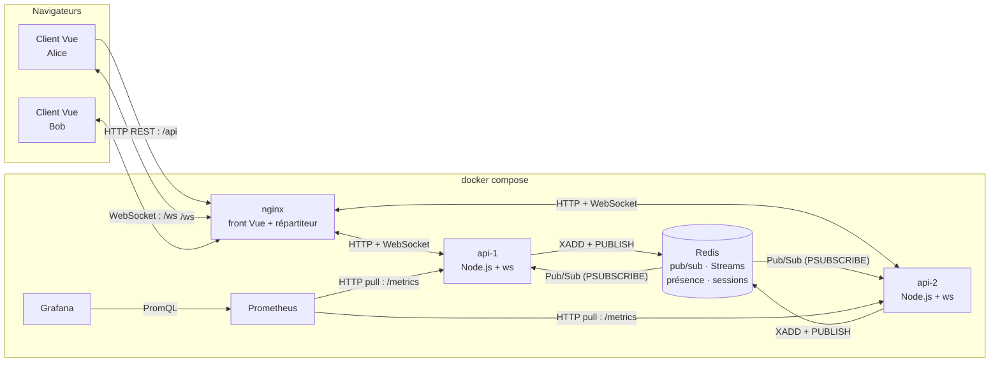

# TubbyChat — Dossier technique

**Projet fil rouge · Web temps réel · Groupe 3**
Membres : Evan Louis · Alix Pratabuy · Yoann Goumarre
Dépôt : https://github.com/goumarry/tubbychat · Lancement : `docker compose up --build` → http://localhost:8090

---

## Sommaire

1. Contexte, utilisateurs, scénario principal
2. Architecture : schéma, composants, flux et techniques
3. Décisions et alternatives comparées
4. Contrat de messages
5. Sécurité : authentification, origine, validation, débit, chiffrement
6. Robustesse : reconnexion, reprise, présence
7. Passage à l'échelle : broker, instances, garanties de livraison
8. Mesures : protocole, résultats, optimisation avant/après
9. Limites et pistes
10. Annexe : USAGE-IA.md

---

## 1. Contexte, utilisateurs, scénario principal

**TubbyChat** est une messagerie temps réel avec **salons**, **présence** et **accusés de lecture**, sur le thème des Télétubbies. Elle correspond au cadre IW « application collaborative ou messagerie ». Chaque utilisateur choisit un Tubby (violet, vert, jaune ou rouge) et discute dans cinq salons : La Colline, La Maison Tubby, Le Jardin, Le Soleil, et Le placard de Noo-Noo, réservé aux administrateurs.

| Profil | Besoin |
|--------|--------|
| **Membre** (étudiant d'une promo) | Discuter par thème, voir qui est là, savoir si son message a été lu, ne rien perdre en cas de coupure |
| **Administrateur** | Accéder en plus à un salon réservé (démonstration des contrôles d'autorisation) |

**Scénario principal**
1. Alice crée son Tubby (pseudo, mot de passe, couleur) ou se connecte.
2. Elle rejoint « La Colline » : elle voit les derniers messages et les Tubbies en ligne (leur antenne est allumée).
3. Elle écrit : Bob, sur un autre navigateur **et une autre instance du serveur**, reçoit le message en quelques dizaines de millisecondes.
4. Bob lit le message : Alice voit « Lu par bob ».
5. Alice perd le réseau 10 s : le soleil passe derrière un nuage, le client se reconnecte seul et rattrape les messages manqués.

Toutes les données sont réelles (des utilisateurs qui écrivent) : aucun flux simulé, aucune API payante.

**Interface.** Ciel en dégradé, collines, fleurs et moulin ; les messages défilent dans un « écran-ventre » gris clair. Le soleil indique l'état de la connexion et l'instance utilisée. Trois fleurs qui poussent signalent qu'un utilisateur écrit. Toutes les illustrations sont des **SVG originaux** dessinés dans le code : aucune image officielle n'est utilisée (les personnages appartiennent à WildBrain).

---

## 2. Architecture : schéma, composants, flux et techniques

| Flux | Sens | Technique | Pourquoi |
|------|------|-----------|----------|
| Messages, saisie en cours, lectures, présence | navigateur ⇄ serveur | **WebSocket** | Échanges fréquents dans les deux sens |
| Inscription, connexion, ticket, liste des salons | navigateur → serveur | **HTTP REST** | Actions ponctuelles, protégées par cookie |
| Diffusion entre instances | serveur → serveurs | **Redis Pub/Sub** | Alice sur api-1 doit atteindre Bob sur api-2 |
| Historique et reprise | serveur ⇄ Redis | **Redis Streams** | Identifiants ordonnés : « tout ce qui suit l'id X » |
| Métriques | Prometheus → serveurs | **HTTP pull** | Format standard de Prometheus |

| Composant | Rôle |
|-----------|------|
| **Client Vue 3** | Interface. `socket.js` gère le ticket, la reconnexion, la reprise et la file d'envoi ; `store.js` (un `reactive()`) tient messages, présence et lectures |
| **nginx** | Sert le front compilé, répartit `/api` et `/ws` entre les deux instances, journalise sans query string, ajoute la CSP, bloque `/metrics` |
| **api-1, api-2** | Le même code Node.js (`ws` + `node:http`), lancé deux fois. Aucun état local important : tout ce qui est partagé est dans Redis |
| **Redis 7.4** | Broker (pub/sub) et stockage : historique (Streams), présence (sorted sets), lectures (hash), sessions et tickets (clés à durée de vie), comptes (mot de passe `scrypt`). Persistance AOF |
| **Prometheus + Grafana** | Relevé des métriques toutes les 5 s ; tableau de bord provisionné depuis le dépôt |

**Parcours d'un message.** Alice (api-1) envoie `chat`. api-1 vérifie la taille, le débit, le schéma et l'appartenance au salon. Il dédoublonne (`SET NX`), **écrit dans le Stream** (`XADD`, id ordonné), renvoie un `ack` à Alice, puis **publie** sur `room:colline`. Redis transmet la publication aux deux instances, et chacune l'envoie à ses sockets membres du salon : Bob (api-2) le reçoit. L'écriture durable précède la publication éphémère : si la publication se perd, la reprise rattrape le message.

---

## 3. Décisions et alternatives comparées

| Décision | Choix retenu | Alternative 1 | Alternative 2 | Justification |
|----------|---------|---------------|---------------|---------------|
| Technique temps réel | WebSocket | SSE + POST | Long polling | Communication dans les deux sens, fréquente. SSE est unidirectionnel (un POST par action) ; le long polling coûte une requête par message |
| Bibliothèque serveur | `ws` | Socket.IO | uWebSockets.js | Proche du protocole : reconnexion, salons et sécurité sont écrits par nous, donc expliqués. Socket.IO les masquerait ; uWS est moins documenté |
| Broker | Redis | NATS | Kafka | Un seul service pour diffusion, historique, présence, sessions et tickets. NATS ne fait que la diffusion ; Kafka est surdimensionné |
| Historique | Redis Streams | PostgreSQL | MongoDB | Ids ordonnés, parfaits pour la reprise ; pas de conteneur ni d'ORM en plus. Limite : 1000 messages par salon |
| Authentification WebSocket | Ticket à usage unique (30 s) | JWT dans l'URL | Jeton au 1er message | Pas d'en-tête `Authorization` possible ; un JWT dans l'URL finit dans les journaux ; le jeton au 1er message accepte des connexions anonymes. Le ticket refuse dès la poignée de main |
| Répartiteur | nginx | HAProxy | Traefik | Sert aussi le front : un conteneur de moins. Configuration WebSocket bien documentée |
| Front | Vue 3 + Vite | React | Sans framework | La réactivité met à jour seule présence et messages ; HTML échappé par défaut |
| Format | JSON | MessagePack | Protobuf | Lisible dans l'onglet Réseau, donc vérifiable par rapport au contrat |
| Outil de charge | k6 | Artillery | Script Node | Script JS versionné, WebSocket intégré, percentiles fournis |
| Garantie de livraison | Au moins une fois + dédoublonnage | Au plus une fois | Exactement une fois | Le pub/sub seul perd les messages pendant une coupure ; « exactement une fois » est irréalisable de bout en bout |
| Optimisation | Regroupement des envois | Compression `permessage-deflate` | MessagePack | La mesure montre que le coût dominant est le nombre de `ws.send` (250 par message reçu), pas la taille : regrouper attaque directement ce coût |

Choix de simplicité assumés : pas de Pinia (un `reactive()` suffit), pas de Zod (validation de 80 lignes écrite à la main), pas de bibliothèque de journalisation (JSON maison avec masquage).

---

## 4. Contrat de messages

Règles : objet JSON avec un champ `type`, 8 Kio au maximum, schéma **strict** (type ou champ inconnu → `error`, la connexion reste ouverte). L'auteur (`from`, `color`) est toujours ajouté par le serveur depuis la session. `id` est un identifiant de Redis Stream (`"1793617914799-0"`). Le serveur peut envoyer un **tableau** de messages (optimisation `BATCH_MS`).

**Client → serveur**

| `type` | Champs | Exemple |
|--------|--------|---------|
| `join` | `room`, `since`? | `{"type":"join","room":"colline","since":"1793617914799-0"}` |
| `leave` | `room` | `{"type":"leave","room":"colline"}` |
| `chat` | `room`, `text` (1–1000), `clientMsgId` | `{"type":"chat","room":"colline","text":"Eh-oh !","clientMsgId":"5f0c…"}` |
| `typing` | `room` | `{"type":"typing","room":"colline"}` |
| `read` | `room`, `upTo` | `{"type":"read","room":"colline","upTo":"1793617914799-0"}` |
| `reauth` | `ticket` | `{"type":"reauth","ticket":"q3Vt0kHq…"}` |

**Serveur → client**

| `type` | Champs |
|--------|--------|
| `welcome` | `user`, `color`, `role`, `instance`, `sessionSeconds` |
| `joined` | `room`, `members[{user,color}]`, `reads{user:id}` |
| `history` | `room`, `messages[]`, `complete`, `resumed` |
| `chat` | `room`, `id`, `from`, `color`, `text`, `at`, `clientMsgId`, `via` |
| `ack` | `clientMsgId`, `id`, `duplicate`? |
| `presence` | `room`, `user`, `status` (online/offline), `color`? |
| `typing` | `room`, `user`, `color` |
| `read` | `room`, `user`, `upTo` |
| `session_expiring` | `inSeconds` |
| `reauth_ok` | `sessionSeconds` |
| `error` | `code` (`invalid_json`, `invalid_message`, `forbidden`, `not_in_room`, `rate_limited`, `internal`), `message` |

**Codes de fermeture** : 1000 normal · 1001 instance arrêtée (reconnexion immédiate) · 1008 débit abusif · 1009 trop gros · 4001 session expirée · 4003 accès révoqué (pas de reconnexion).

**Poignée de main** : 101 si tout va bien, **403** origine refusée, **401** ticket absent, expiré ou déjà utilisé, **429** quota dépassé.

Le contrat complet, avec un exemple JSON pour chaque type et les routes HTTP, est dans `rendus/PHASE1.md` §4. Il est appliqué par `server/src/ws/schema.js`.

---

## 5. Sécurité

| Menace | Mécanisme | Vérification |
|--------|-----------|--------------|
| Connexion anonyme | **Ticket** de 24 octets aléatoires, 30 s, **usage unique** (`GETDEL` dans Redis, donc valable sur les deux instances), obtenu par `POST /api/ws-ticket` avec le cookie de session | Sans ticket → 401 ; faux ticket → 401 ; ticket rejoué → 401 |
| Détournement intersite (CSWSH) | Liste blanche **exacte** des origines (`ALLOWED_ORIGINS`) ; cookie `HttpOnly`, `SameSite=Strict` ; contrôle d'`Origin` sur les `POST` | `Origin: https://evil.example` → 403 |
| Fuite de secret dans les journaux | nginx journalise `$uri` (sans `?ticket=`) ; le journal JSON masque `ticket`, `password`, `cookie`, `sid`, `token`, `hash` | Aucune occurrence de ticket dans `docker compose logs` |
| Épuisement | 5 connexions par utilisateur, 50 par IP (IP prise sur la dernière entrée de `X-Forwarded-For`) → 429 | — |
| Message géant | `maxPayload` 8 Kio → 1009 ; écouteur `ws.on('error')` obligatoire, sinon le processus s'arrête | 20 Kio → 1009, le serveur accepte toujours des connexions |
| Message malformé, usurpation | Validation stricte, champs inconnus refusés, auteur pris dans la session | JSON cassé, mauvais type, champ `from` → `error`, la connexion continue |
| Inondation | Seau à jetons par connexion (10 en rafale, 5/s) ; 3e avertissement → 1008 | Rafale de 30 messages limitée |
| Accès non autorisé | Appartenance au salon pour `chat`/`typing`/`read` ; rôle admin pour le salon réservé | `not_in_room`, `forbidden` |
| Session volée ou expirée | Session WebSocket de 15 min ; `session_expiring` à T-60 s, `reauth` sans coupure ; sinon 4001. « Au revoir ! » révoque **partout** (pub/sub `user:{nom}` → 4003 sur toutes les instances) | 3 renouvellements en 70 s ; déconnexion → 4003 puis plus de ticket possible |
| XSS | Interpolation Vue uniquement, jamais `v-html` ; CSP `default-src 'self'` et `frame-ancestors 'none'` | `` affiché en texte |
| Mots de passe | `scrypt` + sel aléatoire, comparaison `timingSafeEqual` | — |

**Chiffrement.** En local, tout passe en HTTP. En production, nginx ferait la terminaison TLS : la configuration est prête en commentaire, le client passe seul en `wss://` sur une page HTTPS, et `SECURE_COOKIES=1` active `Secure` et le préfixe `__Host-`. **Limite** : cette configuration n'a pas été testée. Il n'y a pas de chiffrement de bout en bout : le serveur lit les messages.

**Recette.** `docker compose exec api-1 npm run test-securite` joue 16 vérifications à travers nginx, dont les trois critères officiels. Résultat : **16/16**.

---

## 6. Robustesse : reconnexion, reprise, présence

**Reconnexion.** Délai `min(10 s, 0,5 s × 2^n)`, tiré au hasard entre 0 et cette valeur (**gigue complète**), remis à zéro après 10 s de connexion stable. Un ticket neuf est demandé à chaque tentative. L'événement `online` et le bouton « Encore ! Encore ! » déclenchent une tentative immédiate ; les codes 1001 et 4001 repartent du délai minimal ; 1000 et 4003 ne provoquent pas de reconnexion. Le plafond a d'abord été de 30 s : une panne de 10 s donnait alors jusqu'à 37 s d'attente. Ramené à 10 s, le retour prend **5 à 10 s**.

**Reprise.** Le client retient le dernier id reçu par salon et renvoie `join` avec `since`. Le serveur répond par les messages strictement postérieurs (`XRANGE (id +`, 500 au maximum). Si des messages ont été supprimés par la limite de 1000 par salon (`XINFO STREAM` → `max-deleted-entry-id`), la réponse porte `complete: false` et le client affiche un bandeau : **la perte est signalée, jamais silencieuse**. Les messages écrits hors ligne attendent dans une file d'envoi et partent à la reconnexion avec leur `clientMsgId` d'origine.

**Présence.** Sorted set `presence:{salon}` dont le score est le dernier battement (toutes les 10 s). Un utilisateur passe hors ligne à la fermeture de sa **dernière** connexion. Si une instance tombe ou si le réseau est coupé, l'entrée périme au bout de 30 s et un nettoyeur la retire (toutes les 5 s). Des `ping` WebSocket toutes les 30 s éliminent les connexions mortes.

| Critère | Annoncé | Mesuré |
|---------|---------|--------|
| Reconnexion après une panne totale de 10 s | automatique | 5 à 10 s ; message en attente livré une seule fois |
| Onglet fermé retiré de la présence | < 2 s | 0,6 s |
| Coupure brutale retirée de la présence | < 35 s | conforme à la conception (30 s + 5 s) |

---

## 7. Passage à l'échelle : broker, instances, garanties

Deux instances (`api-1`, `api-2`) issues de la même image tournent derrière nginx, en *round-robin* et **sans session collante** : l'état partagé est dans Redis. L'instance est visible dans l'interface (« connecté à api-2 »), dans le champ `via` de chaque message et dans chaque ligne de journal. Sur `SIGTERM`, une instance ferme ses sockets avec 1001 : les clients se reconnectent sur l'autre en moins d'une seconde et retrouvent leur historique.

**Garantie annoncée : au moins une fois, avec dédoublonnage ; ordre total par salon.**

| Situation | Traitement |
|-----------|------------|
| Publication perdue (instance coupée de Redis, client déconnecté) | Message déjà dans le Stream ; rattrapé par `join since` |
| Client qui renvoie un message non confirmé | `SET dedupe:{user}:{clientMsgId} NX EX 300` : pas de 2e écriture, renvoi de l'`ack` d'origine (`duplicate: true`) |
| Même message reçu en direct et par la reprise | `Set` des ids déjà affichés côté client |
| Désordre (reprise et direct qui se croisent) | Insertion à sa place par id de Stream, ordre attribué par Redis |
| Ordre entre salons | **Hors périmètre** |

Redis a été préféré à NATS (diffusion seulement, il faudrait un autre stockage pour la présence et les sessions) et à Kafka (journal durable surdimensionné et lourd à exploiter pour un chat).

---

## 8. Mesures : protocole, résultats, optimisation

**Protocole.**

| Élément | Valeur |
|---------|--------|
| Machine | Intel Core i5-13420H (12 cœurs logiques), 7,6 Go de RAM, Windows + WSL2, Docker |
| Pile | nginx → 2 instances Node.js 22 → Redis 7.4, via `docker compose` |
| Générateur | k6 0.54 en conteneur, sur la même machine |
| Montée | 100 → 300 → 600 → 1000 utilisateurs virtuels (20 s de montée, 30 s de palier), puis descente : 3 min 35 s |
| Charge par utilisateur | 1 message toutes les 2 s dans un des 4 salons publics (≈ 250 personnes par salon à 1000 VU), connexion de 60 s renouvelée |
| Horodatage de bout en bout | `Date.now()` dans le texte à l'envoi ; latence = réception de **son propre** message diffusé − horodatage (même horloge) |
| Horodatage serveur | histogramme `ws_message_latency_seconds` : réception sur l'instance d'origine → remise aux sockets sur l'instance de destination |
| Seuil de dégradation | le p95 serveur dépasse 200 ms |
| Conditions | historique vidé avant chaque exécution ; même scénario et même machine avant et après |

**Avant optimisation** (`BATCH_MS=0`, un `ws.send` par message et par destinataire)

| Connexions | Reçus/s | Diffusés/s | p50 serveur | p95 serveur |
|-----------:|--------:|-----------:|------------:|------------:|
| 100 | 47 | 1 050 | 3 ms | 10 ms |
| 300 | 151 | 10 700 | 5 ms | 22 ms |
| 567 | 265 | 32 100 | 5 ms | 42 ms |
| **584** | 293 | 38 200 | 31 ms | **> 2,5 s** |
| 600 | 296 | 34 800 | 1 366 ms | > 2,5 s |

**Seuil de dégradation : environ 580 connexions**, soit environ 35 000 messages diffusés par seconde. Les deux processus Node, qui n'utilisent qu'un cœur chacun, sont saturés. La contre-pression coupe alors les clients trop lents (les connexions retombent de 600 à 404). De bout en bout (k6) : **p50 74 ms, p95 10,24 s**.

**Optimisation : regroupement des envois** (`BATCH_MS=20`). Chaque instance accumule pendant 20 ms les messages destinés à un client, puis les envoie en une seule trame (un tableau JSON).

| Connexions | Reçus/s | p50 serveur | p95 serveur |
|-----------:|--------:|------------:|------------:|
| 300 | 146 | 3 ms | 7 ms |
| 600 | 298 | 3 ms | 19 ms |
| 1 000 | 498 | 5 ms | 39 ms |

| Indicateur (même protocole) | Avant | Après | Gain |
|-----------------------------|------:|------:|-----:|
| p95 de bout en bout | 10,24 s | **143 ms** | ÷ 70 |
| p50 de bout en bout | 74 ms | 34 ms | ÷ 2 |
| Connexions avant dégradation | ≈ 580 | **> 1000** (non atteint) | × 1,7 au moins |
| Ouverture du WebSocket, p95 | 17,9 s | 16 ms | — |
| Messages par trame | ≈ 1 | 2,3 | ÷ 2,3 appels d'envoi |
| Échecs (requêtes ou WebSocket) | 87 délais dépassés | 0 | — |

**Interprétation.** Le goulot d'étranglement n'est pas Redis mais l'envoi : un message dans un salon de 250 personnes produit 250 trames et 250 écritures réseau. Regrouper réduit le nombre d'appels système et le travail de la boucle d'événements. **Contrepartie** : jusqu'à 20 ms de délai ajouté par message. L'option est donc désactivée par défaut pour les démonstrations (une trame par message dans l'onglet Réseau) ; on l'activerait en production.

**Limites de la mesure.** k6 partage le CPU avec les serveurs, ce qui sous-estime la capacité réelle. Une seule exécution a été faite par configuration (le protocole idéal en prévoit trois, avec la médiane). L'histogramme serveur est borné à 2,5 s. La couche réseau de WSL2 et Docker Desktop ajoute un coût.

---

## 9. Limites et pistes

| Limite assumée | Piste |
|----------------|-------|
| Redis, point unique de défaillance | Redis Sentinel (bascule) ou Cluster |
| Historique tronqué à environ 1000 messages par salon (perte signalée au client) | Archivage dans PostgreSQL, Stream gardé comme tampon chaud |
| Chaque instance reçoit tous les salons (`PSUBSCRIBE room:*`) | S'abonner seulement aux salons qui ont des membres locaux |
| Node mono-cœur par instance : saturation vers 580 connexions sans regroupement | Plus d'instances (le pub/sub le permet déjà), regroupement activé, `uWebSockets.js` |
| Pas de TLS testé, pas de chiffrement de bout en bout | Certificat sur nginx (configuration prête) ; chiffrement côté client pour les salons privés |
| Ordre garanti par salon seulement | Suffisant pour une messagerie ; sinon, un Stream unique |
| Dédoublonnage limité à 5 minutes | Allonger la durée de la clé si nécessaire |
| Mesures sur une seule machine, une exécution | Générateur k6 sur une autre machine, 3 exécutions et médiane |

---

## 10. Annexe : USAGE-IA.md

Le journal est tenu au fil de l'eau à la racine du dépôt (`USAGE-IA.md`) : outil utilisé, demandes, vérifications, corrections apportées et réponses refusées avec leur motif. La version PDF du dossier (`rendus/DOSSIER-TECHNIQUE.pdf`) l'inclut automatiquement à cet endroit (`rendus/build-pdf.sh`).
