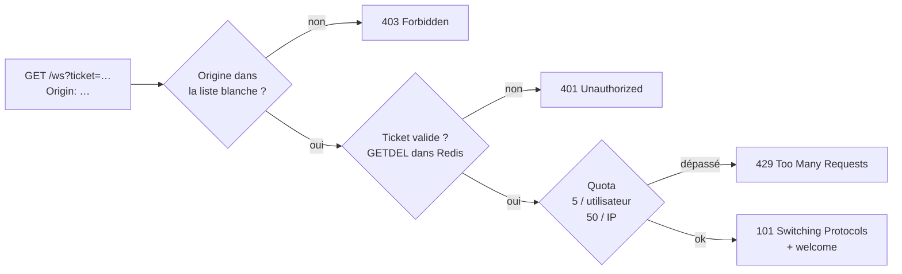

# TubbyChat — Phase 3 : sécurisation, reconnexions et présence

> Projet fil rouge · Web temps réel · Filière IW · Livrables de la phase 3 (J2)

| Livrable demandé | Où | État |
|------------------|----|------|
| Authentification sur la connexion persistante et vérification de l'origine | `server/src/ws/connection.js`, `auth.js` | ✅ |
| Validation des messages entrants, taille maximale, limitation de débit | `ws/schema.js`, `config.js` (`MAX_PAYLOAD`), `ws/ratelimit.js` | ✅ |
| Stratégie de reconnexion côté client (délai croissant, plafond, gigue) et reprise | `client/src/socket.js`, `util.js` | ✅ |
| Présence : liste des utilisateurs connectés | `server/src/presence.js`, `PresenceList.vue` | ✅ |

| Critère de réussite observable | Résultat | Preuve |
|--------------------------------|----------|--------|
| Une connexion sans jeton valide est refusée | **401** | test automatique n° 1 et 2 |
| Une connexion depuis une origine absente de la liste blanche est refusée | **403** | test n° 3, ou `curl` (§2) |
| Un message malformé ou trop gros est rejeté sans arrêter le serveur | `error` (connexion conservée), puis **1009** pour > 8 Kio ; le serveur accepte toujours des connexions | tests n° 5 à 8, 12 et 13 |
| Après une coupure de 10 s, le client se reconnecte seul ; les messages manqués sont rattrapés, ou leur perte est documentée | retour en **5 à 10 s**, messages rattrapés, message écrit hors ligne livré **une seule fois** | §4 |
| Un onglet fermé disparaît de la présence dans un délai annoncé | annoncé : < 2 s (fermeture propre), < 35 s (coupure brutale). Mesuré : **0,6 s** | §5 |

---

## 1. Recette automatique (à jouer devant le formateur)

```bash
docker compose exec api-1 npm run test-securite
```

```text
✔ Connexion sans jeton refusée                     HTTP 401
✔ Connexion avec un faux ticket refusée            HTTP 401
✔ Origine non autorisée refusée                    HTTP 403
✔ Ticket rejoué refusé (usage unique)              HTTP 401
✔ JSON malformé rejeté
✔ Mauvais type de champ rejeté
✔ Champ inconnu (usurpation) rejeté
✔ … la même connexion fonctionne encore
✔ Salon réservé aux admins refusé
✔ Écrire dans un salon non rejoint refusé
✔ Doublon détecté (même id renvoyé)
✔ Message de 20 Kio : fermeture 1009
✔ … et le serveur accepte toujours de nouvelles connexions
✔ Rafale de 30 messages : débit limité
✔ Déconnexion : WebSocket fermé avec 4003
✔ … et la session ne permet plus d'obtenir de ticket

16 réussi(s), 0 échoué(s)
```

Le script (`server/test/securite.test.js`) passe par nginx, comme un vrai navigateur.

## 2. Sécurité de la connexion persistante

### 2.1 Poignée de main : trois contrôles avant d'accepter



| Mécanisme | Détail | Pourquoi |
|-----------|--------|----------|
| **Origine** | Comparaison **exacte** avec `ALLOWED_ORIGINS` (`http://localhost:8090`, …) | Bloque le détournement de WebSocket intersite (CSWSH) : une page malveillante ne peut pas utiliser le cookie de la victime |
| **Ticket** | `POST /api/ws-ticket` (cookie `sid`, `HttpOnly`, `SameSite=Strict`) → 24 octets aléatoires, valables **30 s**, **usage unique** (`GETDEL`), stockés dans Redis donc valables sur les deux instances | Le navigateur ne peut pas mettre d'en-tête `Authorization` sur un WebSocket. Un JWT dans l'URL finirait dans les journaux et resterait valable des heures |
| **Journaux sans secret** | nginx journalise `$uri` (sans `?ticket=`) ; le journal JSON masque `ticket`, `password`, `cookie`, `sid`, `token`, `hash` | Un ticket qui fuite dans un journal est déjà consommé, et n'y apparaît de toute façon pas |
| **Quotas** | 5 connexions par utilisateur, 50 par IP (IP réelle = dernière entrée de `X-Forwarded-For`, ajoutée par **notre** nginx) | Un client ne peut pas épuiser le serveur |
| **CSRF sur l'API** | Les `POST` vérifient aussi l'en-tête `Origin` | Défense en profondeur, en plus de `SameSite=Strict` |

Vérification à la main de l'origine :

```bash
curl -i -H "Connection: Upgrade" -H "Upgrade: websocket" -H "Sec-WebSocket-Version: 13" \
     -H "Sec-WebSocket-Key: dGhlIHNhbXBsZSBub25jZQ==" -H "Origin: https://evil.example" \
     http://localhost:8090/ws
# HTTP/1.1 403 Forbidden
```

### 2.2 Messages entrants : chaque trame passe quatre filtres

| Ordre | Filtre | Si refusé |
|-------|--------|-----------|
| 1 | **Taille** : `maxPayload` = 8 Kio, vérifié par `ws` avant même de lire le contenu | Fermeture **1009**. L'écouteur `ws.on('error')` est obligatoire : sans lui, le processus Node s'arrête |
| 2 | **Débit** : seau à jetons par connexion, 10 en rafale, 5 par seconde | `error rate_limited` ; au 3e avertissement, fermeture **1008** |
| 3 | **Schéma** : JSON valide, type connu, champs attendus et bien typés, aucun champ inconnu, texte de 1 à 1000 caractères, salon `^[a-z0-9-]{1,32}$` | `error invalid_json` ou `invalid_message`, **la connexion reste ouverte** |
| 4 | **Autorisation** : être membre du salon pour `chat`, `typing` et `read` ; être admin pour « Le placard de Noo-Noo » | `error not_in_room` ou `forbidden` |

L'auteur d'un message (`from`, `color`) vient **toujours de la session**. Un champ `from` envoyé par le client est un champ inconnu, donc refusé (test « usurpation »).

### 2.3 Durée de vie de la session

| Événement | Ce qui se passe |
|-----------|-----------------|
| 60 s avant l'échéance (15 min par défaut) | Le serveur envoie `session_expiring` ; le client demande un ticket neuf et envoie `reauth` : **la connexion n'est pas coupée** (vérifié : 3 renouvellements en 70 s avec `SESSION_TTL_SECONDS=60`) |
| Pas de `reauth` à temps | Fermeture **4001**. Le client redemande un ticket et se reconnecte |
| Bouton « Au revoir ! » | `PUBLISH user:alice` : chaque instance ferme toutes les connexions d'Alice avec **4003**, et ses autres onglets reviennent à l'écran de connexion |

### 2.4 Côté client
- Affichage par interpolation Vue `{{ }}` uniquement : `` s'affiche comme du texte.
- nginx ajoute une **CSP** stricte (`default-src 'self'`, `frame-ancestors 'none'`), `nosniff` et `Referrer-Policy: no-referrer`.
- `/metrics` est bloqué depuis l'extérieur (404) : seul Prometheus, dans le réseau Docker, peut le lire.

### 2.5 Chiffrement
En local, tout est en HTTP. En production, nginx ferait la terminaison TLS : la configuration est prête, en commentaire dans `client/nginx.conf`, et le client passe automatiquement en `wss://` quand la page est en HTTPS. Le cookie passerait alors en `Secure` avec le préfixe `__Host-` (`SECURE_COOKIES=1`).

## 3. Stratégie de reconnexion

```js
// client/src/util.js
export function nextDelay(attempt) {
  const exp = Math.min(10_000, 500 * 2 ** attempt);   // 0,5 · 1 · 2 · 4 · 8 · 10 · 10 s…
  return Math.round(Math.random() * exp);              // gigue complète
}
```

| Règle | Valeur | Pourquoi |
|-------|--------|----------|
| Délai croissant | × 2 à partir de 0,5 s | Ne pas marteler un serveur qui vient de tomber |
| Plafond | **10 s** | Avec 30 s, une panne de 10 s donnait jusqu'à 37 s d'attente (mesuré). Avec 10 s : retour en 5 à 10 s |
| Gigue | complète : tirage entre 0 et le délai | 1000 clients coupés en même temps ne reviennent pas tous à la même milliseconde |
| Remise à zéro | après 10 s de connexion stable | Une connexion qui tombe aussitôt ne remet pas le compteur à zéro |
| Ticket | un neuf à chaque tentative | L'ancien est déjà consommé |
| Accélérateurs | événement `online` du navigateur, bouton « Encore ! Encore ! » | Tentative immédiate |
| Pas de reconnexion | codes 1000 et 4003 | Fermeture voulue, ou accès révoqué |

L'état est visible à l'écran : le **soleil** brille (connecté, « connecté à api-1 »), passe **derrière un nuage** (« nouvel essai dans N s »), ou se couche (déconnecté).

## 4. Reprise après coupure

1. Le client retient, par salon, l'id du **dernier message reçu**.
2. À la reconnexion, il renvoie `join` avec `since` = cet id.
3. Le serveur répond `history` avec `resumed: true` et les messages **strictement après** (`XRANGE stream:salon (id +`, 500 au maximum).
4. Si des messages ont été supprimés par la limite de 1000 par salon (`XINFO STREAM` → `max-deleted-entry-id` plus récent que `since`), le serveur répond `complete: false`. Le client affiche un bandeau : **la perte est documentée**.
5. Les messages écrits hors ligne attendent dans une **file d'envoi** (affichés grisés, « envoi… »). Ils partent à la reconnexion avec le même `clientMsgId`. Si le serveur les avait déjà reçus, il ne les enregistre pas une deuxième fois (`SET dedupe:… NX`) et renvoie l'`ack` d'origine.

**Test réalisé (coupure réelle de 10 s)** :

```bash
docker compose stop api-1 api-2     # les deux instances : panne totale côté serveur
# pendant ce temps : Alice écrit un message, qui reste grisé (« envoi… ») dans sa file d'envoi
sleep 10
docker compose start api-1 api-2
```

| Mesure | Résultat |
|--------|----------|
| Temps de reconnexion après le retour des serveurs | 5 à 10 s, sans action de l'utilisateur |
| Message écrit pendant la panne | livré **une seule fois** à tous |
| Messages envoyés par d'autres pendant la déconnexion d'un client | rattrapés via `join since` |

> Pour une démonstration en classe, couper le Wi-Fi du portable 10 s donne le même résultat. Attention : l'option « Hors ligne » des outils de développement de Chrome **ne coupe pas** les WebSockets déjà ouverts ; elle ne convient pas pour cette démonstration.

## 5. Présence

| Mécanisme | Valeur |
|-----------|--------|
| Stockage | sorted set Redis `presence:{salon}`, score = dernier battement |
| Battement de cœur | toutes les **10 s**, par instance, pour ses connexions locales |
| Plusieurs onglets | compteur de connexions par utilisateur : on passe hors ligne à la fermeture de la **dernière** |
| Fermeture propre (onglet fermé) | `presence offline` publié immédiatement |
| Coupure brutale (réseau, instance plantée) | entrée périmée après **30 s**, retirée par le nettoyeur (toutes les 5 s) |
| Connexions mortes | `ping` WebSocket toutes les 30 s, `terminate()` sans `pong` |

**Délai annoncé** : un onglet fermé disparaît en **moins de 2 s** (mesuré : **0,6 s**), et en **moins de 35 s** en cas de coupure brutale (30 s d'expiration + 5 s de nettoyage).

À l'écran : l'antenne du Tubby s'éteint dans la liste « Qui est là ? ».

## 6. Limites assumées
- Pas de TLS en local (configuration prête mais non testée en démonstration).
- Le quota par IP suppose que nginx est le seul proxy devant les instances.
- Au-delà de 1000 messages par salon, la reprise est incomplète (signalé au client, jamais silencieux).
