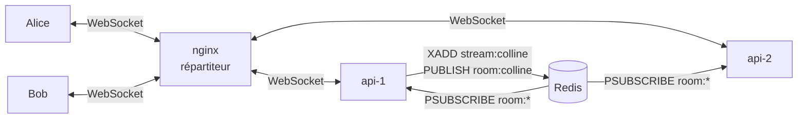

# TubbyChat — Phase 4 : passage à l'échelle, broker pub/sub et plusieurs instances

> Projet fil rouge · Web temps réel · Filière IW · Livrables de la phase 4 (J2 fin, J3)

| Livrable demandé | Où | État |
|------------------|----|------|
| Au moins deux instances du serveur derrière un répartiteur | `api-1`, `api-2` derrière nginx (`docker-compose.yml`, `client/nginx.conf`) | ✅ |
| Un broker (justifié) | Redis 7.4 : pub/sub + Streams (`server/src/broker.js`) | ✅ |
| Garantie de livraison annoncée et traitement des doublons | « au moins une fois » + dédoublonnage (§4) | ✅ |

| Critère de réussite observable | Résultat |
|--------------------------------|----------|
| Deux clients connectés à deux instances différentes échangent (instance visible) | ✅ « connecté à api-1 » / « api-2 » sous le soleil ; champ `via` de chaque message ; champ `instance` de chaque ligne de journal |
| L'arrêt d'une instance n'empêche pas les clients de se reconnecter sur l'autre | ✅ fermeture 1001, puis reconnexion sur l'autre instance en moins de 1 s |
| Le comportement en cas de doublon ou de désordre est démontré ou explicitement hors périmètre | ✅ doublons démontrés (test automatique + panne) ; ordre garanti par salon ; ordre entre salons **hors périmètre** |

---

## 1. Architecture multi-instance



| Élément | Choix | Raison |
|---------|-------|--------|
| Instances | même image Docker, seule `INSTANCE_ID` change (ancre YAML `x-api`) | Aucun code spécifique à une instance |
| Répartition | nginx, *round-robin*, `resolve` sur le DNS Docker | Une instance redémarrée est retrouvée même si son IP change |
| Session collante | **aucune** | Un WebSocket reste par nature sur son instance ; tout l'état partagé (sessions, tickets, historique, présence) est dans Redis |
| Bascule | `proxy_next_upstream error timeout` + `max_fails=1 fail_timeout=5s` | Une instance arrêtée est évitée dès la première erreur |
| Arrêt propre | `SIGTERM` → chaque socket est fermé avec **1001** | Le client sait qu'il doit se reconnecter immédiatement |

### Pourquoi Redis comme broker

| | **Redis** ✅ | NATS | Kafka |
|---|---|---|---|
| Diffusion entre instances | pub/sub | oui (cœur du produit) | oui (topics) |
| Historique ordonné pour la reprise | **Streams** (même service) | JetStream (à activer) | oui, c'est un journal |
| Présence, sessions, tickets à durée de vie | oui (sorted sets, `EX`) | non : il faudrait un autre stockage | non |
| Coût de mise en place | 1 conteneur, 0 configuration | 1 conteneur + JetStream | ZooKeeper/KRaft, partitions : lourd |

Un seul service couvre les cinq besoins. Kafka serait justifié pour des millions de messages durables par seconde, ce qui n'est pas notre cas.

## 2. Ce que chaque instance fait d'un message

1. Alice (sur api-1) envoie `chat`.
2. api-1 valide, dédoublonne, puis **écrit dans le Stream** (`XADD`) : le message est durable et reçoit un id ordonné.
3. api-1 **publie** sur `room:colline`.
4. Redis transmet la publication à **toutes** les instances abonnées (`PSUBSCRIBE room:*`), y compris api-1.
5. Chaque instance l'envoie à **ses** sockets locaux membres du salon (`byRoom`, `server/src/ws/state.js`). Bob, sur api-2, le reçoit.

L'ordre « Stream puis pub/sub » compte : si la publication se perd, le message existe déjà dans le Stream et sera rattrapé à la reprise.

La révocation suit le même chemin, sur un canal par utilisateur (`user:alice`) : un « Au revoir ! » cliqué sur api-2 ferme aussi les onglets d'Alice connectés à api-1.

## 3. Démonstration (jalon J3, avant la pause)

```bash
docker compose up -d
# 1. Deux navigateurs : recharger l'un des deux jusqu'à voir « api-1 » d'un côté et « api-2 » de l'autre
# 2. Échanger des messages : le champ "via" (onglet Réseau) montre l'instance qui a reçu le message

# 3. Les journaux montrent les deux instances
docker compose logs -f api-1 api-2 | grep -E "connexion acceptée|connexion fermée"

# 4. Arrêt d'une instance
docker compose stop api-1
#    → les clients d'api-1 reçoivent 1001 et se reconnectent sur api-2 (le soleil affiche « api-2 »)
#    → la conversation continue, l'historique est intact
docker compose start api-1
```

Pour voir le message traverser les deux instances : `LOG_MESSAGES=1 docker compose up -d api-1 api-2`. On observe un `ws ←` sur l'instance d'Alice, puis un `ws →` par destinataire sur **chaque** instance.

## 4. Garantie de livraison

> **Annoncée : « au moins une fois » vers les clients, avec dédoublonnage. Ordre total garanti à l'intérieur d'un salon.**

Redis pub/sub seul est « au plus une fois » : un abonné déconnecté au moment de la publication ne la reçoit jamais. La garantie « au moins une fois » vient de la combinaison de trois mécanismes :

| Mécanisme | Ce qu'il apporte |
|-----------|------------------|
| Écriture dans le Stream **avant** la publication | Tout message accepté (`ack`) est durable |
| Reprise `join since` à chaque reconnexion | Ce qui a été manqué en direct est renvoyé |
| File d'envoi du client + même `clientMsgId` | Un message non confirmé est renvoyé jusqu'à son `ack` |

Le prix de « au moins une fois », ce sont les **doublons**. Ils sont traités des deux côtés :

| Situation | Doublon possible | Traitement | Démontré par |
|-----------|------------------|------------|--------------|
| Le client renvoie un message après une coupure (l'`ack` s'est perdu) | côté serveur | `SET dedupe:{user}:{clientMsgId} NX EX 300` : déjà vu → pas de 2e `XADD`, renvoi de l'`ack` d'origine avec `duplicate: true` | test n° 11 de `npm run test-securite` ; panne de 10 s (message livré une seule fois) |
| Reprise et diffusion en direct se croisent | côté client | `Set` des ids déjà affichés dans `store.js` | panne de 10 s |
| Message reçu par l'expéditeur (diffusion + affichage optimiste) | côté client | rapprochement par `clientMsgId` | à chaque message |

| Ordre | Garanti ? | Comment |
|-------|-----------|---------|
| Dans un salon | **Oui** | Les ids de Stream sont attribués par Redis, dans un ordre total. Le client insère chaque message à sa place par id (`cmpId`), même s'il arrive en retard par la reprise |
| Messages d'une même connexion | Oui | Traités à la suite (`ws.chain`), jamais en parallèle |
| Entre deux salons | **Non, hors périmètre** | Aucun intérêt pour l'utilisateur : chaque salon s'affiche séparément |

« Exactement une fois » n'est pas promis : ce n'est pas réalisable de bout en bout sur un réseau non fiable. On obtient l'**effet** d'exactement une fois à l'affichage grâce au dédoublonnage.

## 5. Résultats vérifiés

| Test | Résultat |
|------|----------|
| Alice sur api-1, Bob sur api-2, échange de messages | ≈ 51 ms de bout en bout |
| `docker compose stop api-1` avec des clients dessus | 1001, reconnexion sur api-2, conversation continue |
| Panne des deux instances pendant 10 s | reconnexion en 5 à 10 s, message en attente livré une seule fois |
| Présence vue depuis l'autre instance | mise à jour en 0,6 s à la fermeture d'un onglet |

## 6. Limites assumées
- **Redis est un point unique de défaillance.** En production : Redis Sentinel ou Cluster (hors périmètre).
- **Chaque instance reçoit tous les salons** (`PSUBSCRIBE room:*`), même ceux sans membre local. C'est simple et suffisant pour 5 salons ; avec des milliers de salons, il faudrait s'abonner salon par salon.
- La clé de dédoublonnage dure 5 min : un client qui renverrait un message après plus de 5 min de coupure créerait un doublon (cas jugé négligeable).
